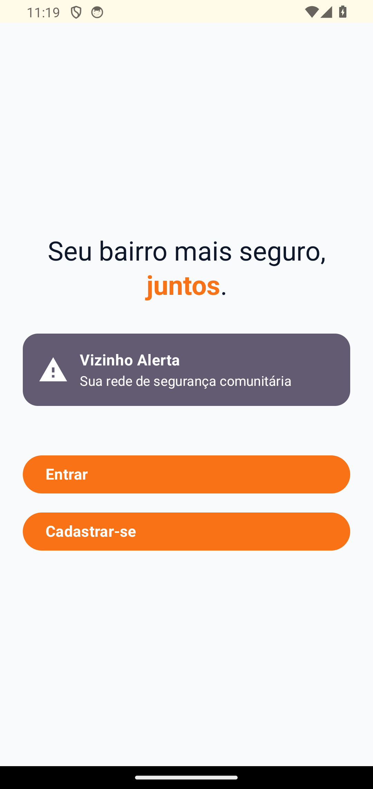
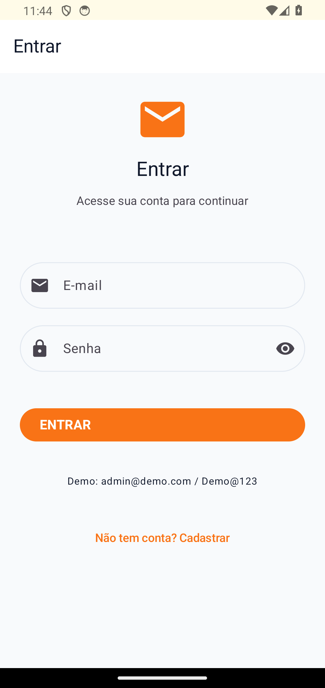
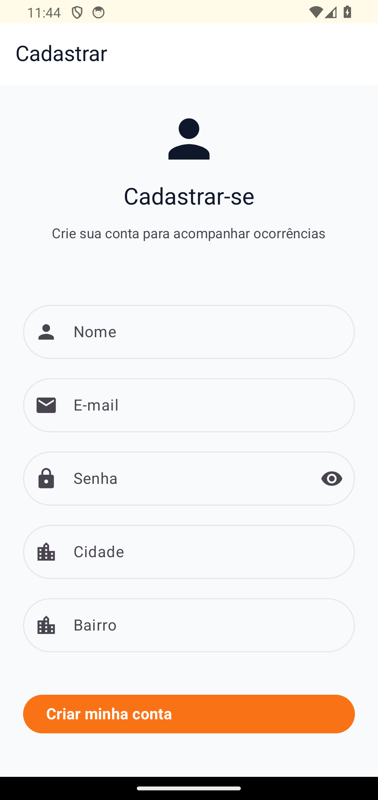
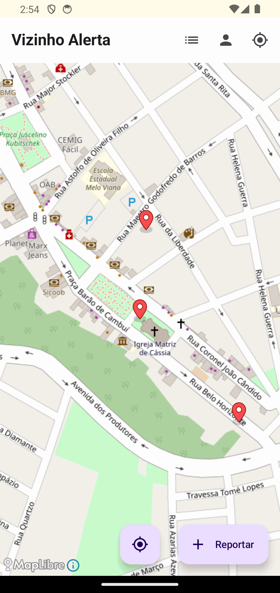
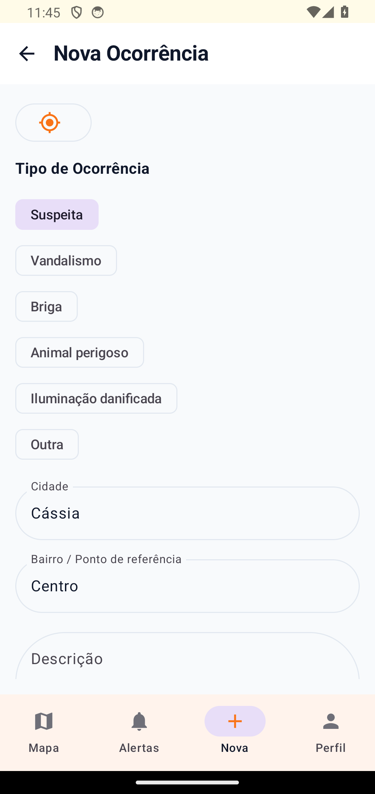
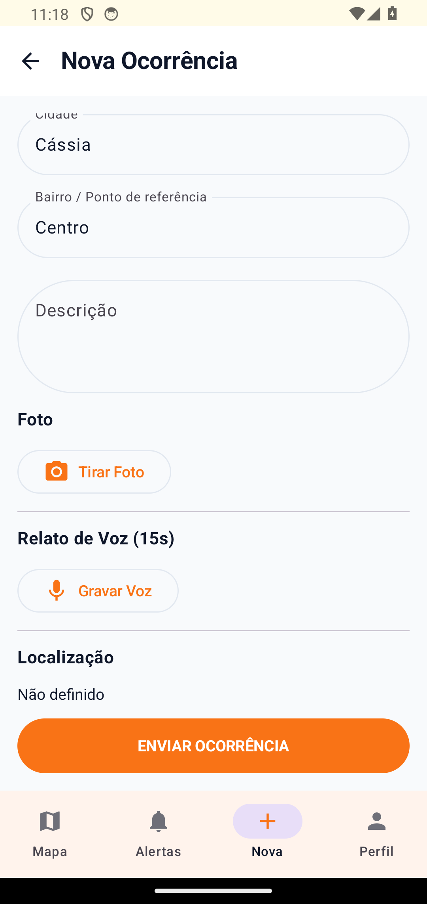
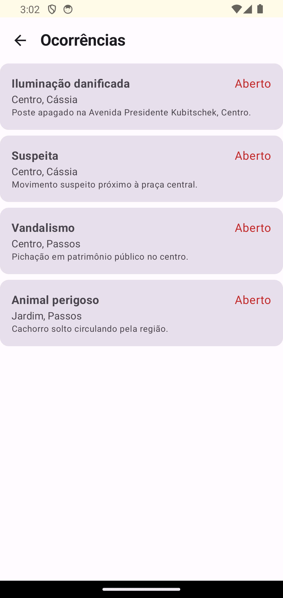
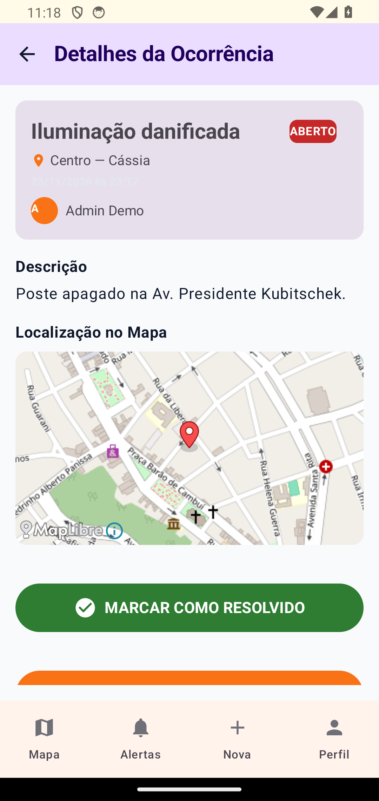
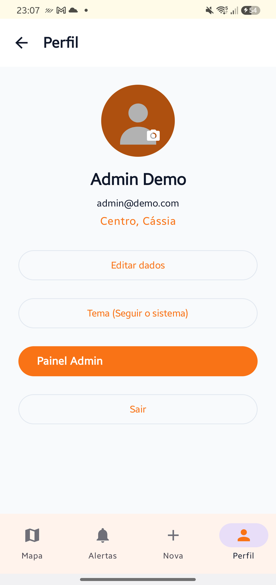
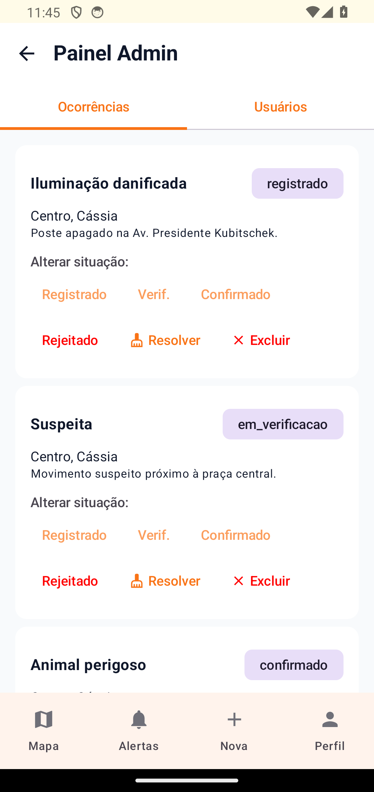

# Vizinho Alerta

App Android (Kotlin) de segurança comunitária para reportar ocorrências com foto, áudio, GPS e cidade, usando câmera, microfone, GPS e internet.

## Ideia do projeto
Moradores registram situações suspeitas ou problemas urbanos (rua escura, vandalismo, briga, animal perigoso, iluminação danificada) com evidências multimídia. As ocorrências aparecem em mapa compartilhado em tempo real, permitindo que vizinhos vejam o que acontece na região e marquem como resolvido.

## Recursos do equipamento usados
- **Câmera (CameraX):** foto da evidência
- **Microfone:** relato de voz de 10-15s
- **GPS (FusedLocation):**latitude/longitude automáticas
- **Internet (Firebase):** mapa/feed compartilhado via Auth, Firestore e Storage

## Tecnologias
- **Kotlin + Jetpack Compose** (Material 3)
- **MapLibre SDK** (OpenStreetMap) - **NÃO precisa de API Key!**
- **CameraX** para captura de fotos
- **MediaRecorder** para áudio de 15 segundos
- **FusedLocationProviderClient** para GPS
- **Firebase Auth + Firestore + Storage + Realtime Database**
- **Google Sign-In** (login via Gmail)

## Estrutura
```
app/src/main/java/com/vizinhoalerta/
├── MainActivity.kt
├── model/
│   ├── Ocorrencia.kt
│   └── Usuario.kt
├── data/
│   ├── AuthRepository.kt
│   └── OcorrenciaRepository.kt
├── ui/
│   ├── login/
│   ├── mapa/
│   ├── reportar/
│   ├── detalhes/
│   ├── lista/
│   ├── perfil/
│   └── admin/
│       └── AdminScreen.kt
└── service/
    ├── CameraService.kt
    ├── LocalizacaoService.kt
    └── AudioService.kt
```

## Funcionalidades MVP

### Autenticação
- Login e cadastro com email/senha
- **Login via Google** (Gmail) com token de conexão
- Validação de senha: 8+ chars, maiúscula, número, caractere especial
- Perfil do usuário com cidade e bairro

### Mapa e Localização
- **Mapa com localização do usuário em azul** (Blue Dot)
- Botão "Local Atual" → recente a câmera para a posição do usuário
- Clique no mapa → menu de confirmação da escolha do local
- Escolha local: clique no mapa ou use GPS automático

### Ocorrências
- Nova ocorrência: foto + áudio + GPS + cidade + bairro customizado
- Feed de ocorrências em tempo real com marcadores coloridos
- Detalhes: foto, reprodução de áudio, mapa de localização
- Botão "Marcar como Resolvido"
- **Paleta de cores moderna** (verde=resolvido, vermelho=aberto, azul=seu local)

### Navegação
Welcome → Login → Mapa → Reportar/Detalhes/Lista/Perfil/Admin

## Interface

Capturas do app rodando no emulador Android 14 (1080×2280).

| | |
|---|---|
|  **Welcome** |  **Login** |
|  **Cadastro** |  **Mapa** |
|  **Nova ocorrência** |  **Mídia e envio** |
|  **Lista** |  **Detalhes** |
|  **Perfil** |  **Painel Admin** |

## Regras de Segurança (Firestore & Storage)

### Firestore Rules
As regras de segurança estão em `firestore.rules`:

| Operação | Permissão |
|---|---|
| **Leitura de ocorrências** | Qualquer usuário autenticado |
| **Criar ocorrência** | Usuário autenticado (userId = auth.uid) |
| **Atualizar ocorrência** | **Apenas o autor** da ocorrência (userId) **OU admin** (custom claims) |
| **Deletar ocorrência** | **Apenas o autor** da ocorrência (userId) **OU admin** |

#### Estados das ocorrências
- **situacao** (editor pelo autor): `registrado` → `resolvido` ou `rejeitado`
- **status** (unificado): `aberto` ↔ `resolvido`
- Estados `em_verificacao`, `confirmado` reservados para moderação futura

### Storage Rules
As regras de segurança estão em `storage.rules`:

| Caminho | Operação | Permissão |
|---|---|---|
| `fotos/{uid}/{file}` | Leitura | Usuário autenticado |
| `fotos/{uid}/{file}` | Escrita | **Só o dono** (auth.uid == uid) |
| `audios/{uid}/{file}` | Leitura | Usuário autenticado |
| `audios/{uid}/{file}` | Escrita | **Só o dono** (auth.uid == uid) |

#### Limites de tamanho
- **Fotos:** ≤ 5 MB, tipo MIME `image/*`
- **Áudios:** ≤ 2 MB, tipo MIME `audio/*`

### Configuração de Admin (Custom Claims)
Para habilitar o painel administrativo, configure Custom Claims no Firebase:

```bash
# Usando Firebase Admin SDK
admin.auth().setCustomUserClaims(uid, { admin: true })
```

Isso permite que o usuário com UID especificado altere/remova ocorrências de outros usuários e acesse a coleção de moderação.

## Funcionalidades de Administração

### Painel Admin (`/admin`)
- Listagem de todas as ocorrências
- Alteração de estados: registrado, em verificação, confirmado, resolvido, rejeitado
- Exclusão de ocorrências com limpeza automática de mídia
- Acesso via navegação ou rota direta

### Limpeza de mídia
Ao excluir uma ocorrência via Admin, o sistema também remove:
- Foto em `fotos/{uid}/{ocorrenciaId}.jpg`
- Áudio em `audios/{uid}/{ocorrenciaId}.m4a`

## Como rodar

### google-services.json (protótipo)
Se você não tiver um `google-services.json` próprio, não precisa fornecer nada: o build gera `app/google-services.json` automaticamente a partir do template `app/google-services.example.json` (com chave fictícia `DUMMY`). Isso basta para rodar o **debug**, que aponta para os emuladores locais (Auth `9099`, Firestore `8081`, Storage `9199`).

Para gerar um release, substitua o arquivo pelo `google-services.json` real do seu projeto Firebase. Se a chave fictícia ainda estiver presente, o build falha com a mensagem: `Release exige um google-services.json real (sem DUMMY)`.

> O `app/google-services.json` gerado é gitignored: nunca commite o arquivo com chave, real ou fictícia.

### 1. Firebase (gratuito)
1. Acesse https://console.firebase.google.com
2. Crie um projeto chamado `vizinho-alerta`
3. Clique em **Android** → insira `com.vizinhoalerta` como package name
4. Baixe o `google-services.json` → cole em `app/`
5. Em **Authentication** → habilite métodos:
   - Email/Senha
   - Google Sign-In
6. Em **Firestore Database** → crie banco em modo **locked**
7. Em **Storage** → crie bucket padrão
8. Ative o **Realtime Database** (para token de conexão)

### 2. Sincronizar o Gradle
Abra o projeto no Android Studio → **File** → **Sync Project with Gradle Files**

### 3. Executar
Compile e rode no emulador ou dispositivo físico.

### 4. Dados simulados (emulador)

Com os emuladores locais de Auth/Firestore rodando, popular o app com o usuário de teste e 4 ocorrências em Cássia/MG e Passos/MG:

```bash
python3 scripts/seed_emulador.py
```

O script é idempotente (IDs fixos) e pode ser executado novamente após reiniciar os emuladores. Login: `teste@exemplo.com` / `Teste@123`.

## Testes

### Testes Unitários
```bash
# Rodar testes de modelo
./gradlew testDebugUnitTest
```

Testa:
- `OcorrenciaTest.kt` - validações de modelo e constantes
- `UsuarioTest.kt` - verificação de isAdmin
- `LocalizacaoServiceTest.kt` - validação de coordenadas

### Testes de UI (Instrumented)
```bash
# Rodar testes de UI
./gradlew connectedDebugAndroidTest
```

Testa:
- `LoginFlowTest.kt` - fluxo de login/registro
- `ValidationTest.kt` - validação de senha

## Stack
Kotlin, Jetpack Compose, MapLibre (OpenStreetMap), CameraX, FusedLocation, Firebase (Auth, Firestore, Storage, Realtime DB), Google Sign-In

## Entrega
Trabalho individual — disciplina de programação mobile (prazo 05/12/2026)